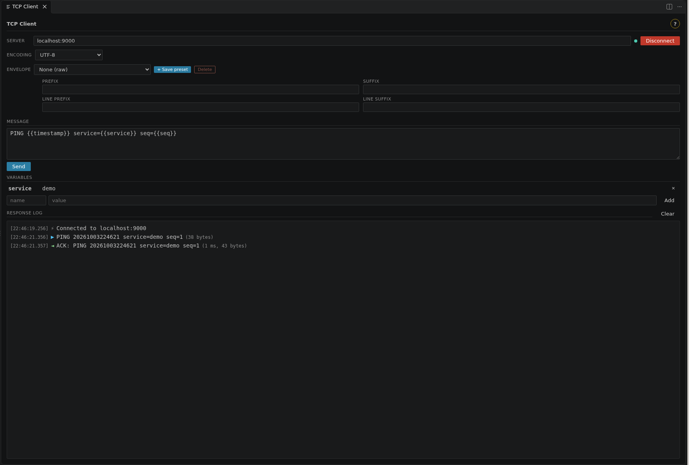

# TCP Client for VS Code

Connect to any TCP server, send text or binary messages, and inspect the data received—all without leaving VS Code.



## Quick start

1. Run **TCP Client: Open Panel** from the Command Palette.
2. Enter a `host:port` address and click **Connect**.
3. Choose an envelope and encoding, then enter a message.
4. Click **Send** or press `Ctrl+Enter`. Use **?** for syntax help.

The panel includes built-in HL7 envelopes, custom presets, message variables, and a send/receive log. The status dot shows connection state (grey: disconnected, amber: connecting, green: connected). Log entries include timestamps and byte counts; the first received TCP data chunk after a send also shows elapsed time in milliseconds. TCP chunks are not necessarily complete application responses.

Choose UTF-8, ASCII, Latin-1, or UTF-16 LE for outgoing text. The draft message persists across panel closure and VS Code restarts. Connection, encoding, and envelope preferences last only while the panel remains open.

## Message syntax

Escape sequences let you include binary bytes in a message:

| Sequence | Meaning |
|---|---|
| `\xHH` | Raw byte, e.g. `\xFF` |
| `\n` | Newline (0x0A) |
| `\r` | Carriage return (0x0D) |
| `\t` | Tab (0x09) |
| `\\` | Literal backslash |
| `\0` | Null byte (0x00) |
| `\{` `\}` | Literal braces; use `\{\{name\}\}` to send `{{name}}`, even if `name` is defined |

Insert variables with `{{name}}`:

| Variable | Description |
|---|---|
| `{{timestamp}}` | Current UTC time |
| `{{timestamp|FORMAT}}` | UTC time using `YYYY` (year), `MM` (month), `DD` (day), `HH` (hour), `mm` (minute), `ss` (second), `sss` (milliseconds), `Z` (UTC marker), `X` (epoch seconds), or `x` (epoch milliseconds) |
| `{{seq}}` | Per-panel counter, starting at 1 |
| `{{uuid}}` | New UUID v4 |
| `{{your.name}}` | A custom variable you add in the panel or settings |

Add custom variables in the panel or in `settings.json`:

```json
{
  "tcpClient.variables.custom": [
    { "name": "user.name", "value": "Rui" }
  ],
  "tcpClient.variables.timestampFormat": "YYYYMMDDHHmmss"
}
```

Unknown variables are sent unchanged and logged as a developer-console warning. A `|FORMAT` suffix only formats `timestamp`; it is ignored for `seq`, `uuid`, and custom variables.

## Envelopes

Choose **None (raw)**, **HL7 v2 (MLLP framing)**, or **HL7 v2 (raw LLP, no VT)**, or create a custom preset. Prefix/suffix bytes wrap the whole message. Optional line-prefix/line-suffix bytes wrap each newline-separated line inside that outer framing. Input newlines are consumed (no separator is added); set a line suffix if the protocol needs one. Empty lines, including a trailing empty line, are wrapped too.

Edit all four fields in the panel. Framing fields use the same escape sequences as messages. Use **+ Save preset** to save the current values or **Delete** to remove a custom preset. You can also configure presets in `settings.json`; each requires a unique `id` and a `label` shown in the dropdown, while framing fields are optional:

```json
{
  "tcpClient.envelopes.custom": [
    { "id": "stx-etx", "label": "STX/ETX", "prefix": "\\x02", "suffix": "\\x03" },
    { "id": "marked-lines", "label": "Marked lines", "linePrefix": ">", "lineSuffix": "\\r" }
  ]
}
```

## Settings

Settings use the `tcpClient.*` namespace:

| Setting | Default | Description |
|---|---|---|
| `tcpClient.connection.timeoutMs` | `10000` | Connect timeout in ms; set to `0` to disable |
| `tcpClient.variables.custom` | `[]` | User-defined `{name, value}` variables |
| `tcpClient.variables.timestampFormat` | `YYYYMMDDHHmmss` | Default format for `{{timestamp}}` |
| `tcpClient.envelopes.custom` | `[]` | Custom envelope presets |

## Keyboard

| Shortcut | Action |
|---|---|
| `Ctrl+Enter` | Send the current message |
| `Escape` | Close syntax help |

## License

MIT
